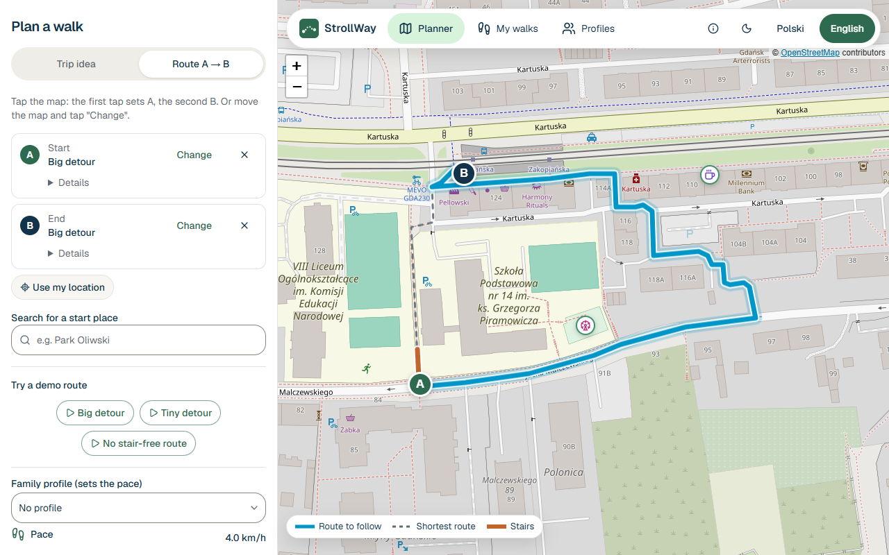
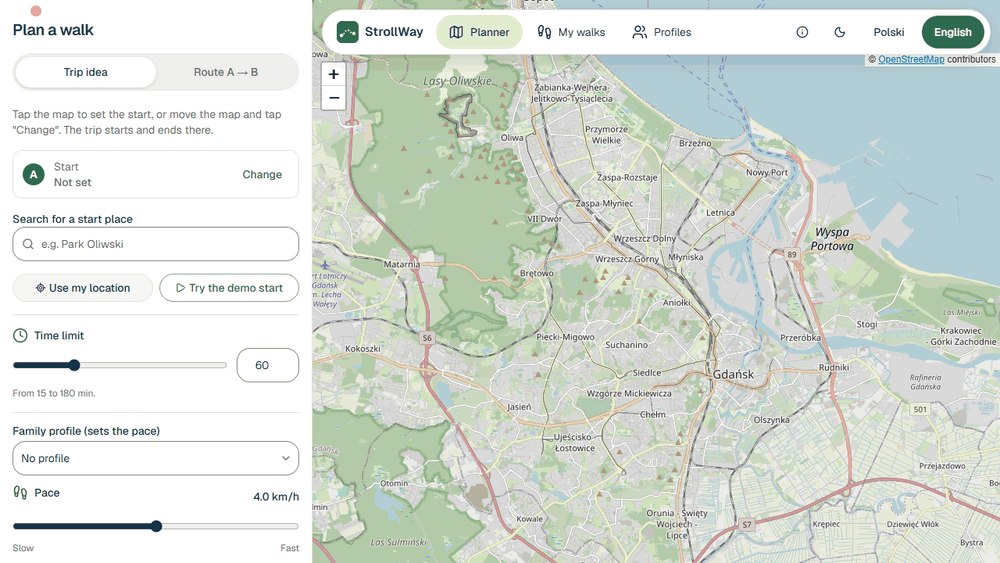
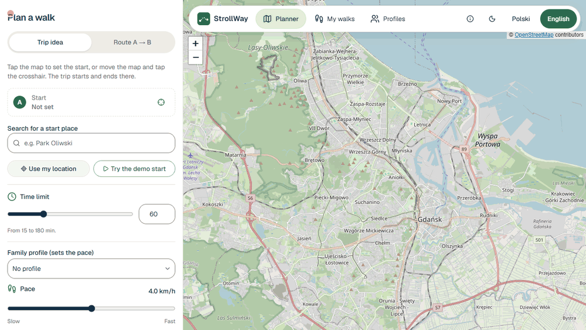
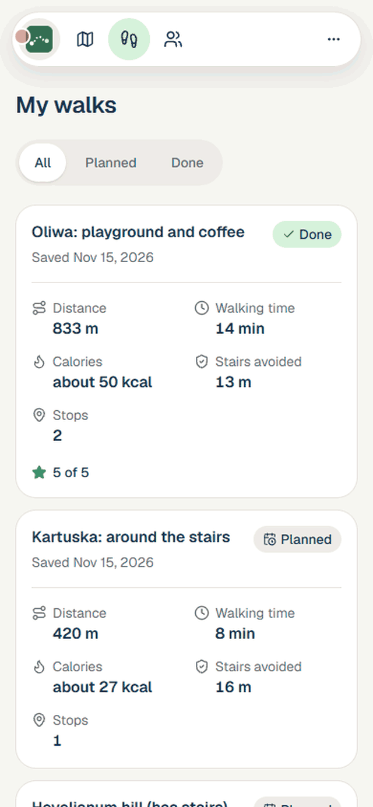
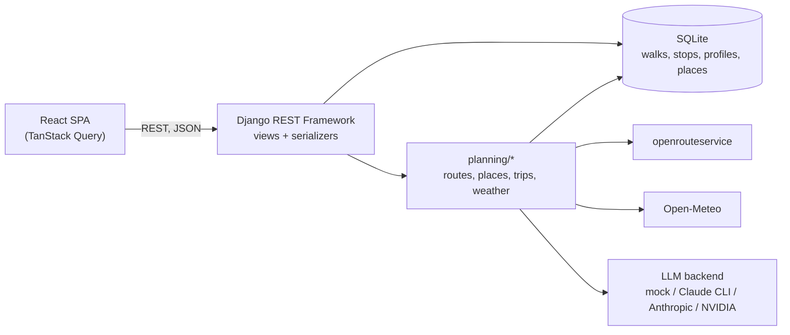

# StrollWay - stair-free walks for families

StrollWay plans walks without stairs for families with a stroller or a balance bike, and
suggests short family trips with stops on the way.

**Live demo:** _coming soon_ <!-- TODO(stage 8): add the link after the deploy -->



## What it does

- **Stair-free routes, compared with the shortest one.** You see both routes on the map, the
  stairs on the shortest route, and what the detour costs in metres. When there is no
  stair-free route, the app says so.
- **Trip ideas.** A start point, a time limit and a few wishes in plain words ("playground, then
  coffee") become a checked trip with stops. AI picks the stops; code checks every answer.
- **Places on the way** from OpenStreetMap: playgrounds, cafes, toilets, benches and more, with
  opening hours.
- **Open in Google Maps:** take the planned route to your phone's navigation, with a warning
  when the Google route may have stairs.
- **Best time for a walk:** the next good weather windows for your start point.
- **Saved walks, stops and family profiles** (full CRUD). A profile sets the pace and the trip
  defaults.
- **Works on a phone**, in Polish and English, in a light and a dark theme.
- **Runs with no API keys** (demo mode), so you can try it right after cloning.
- **"How it works" page** in the app: the same limits and data credits as below, in Polish and
  English.

## See it in action

### A stair-free route in one click

The app asks for the shortest route and a route without stairs, then shows both. Here the
shortest way has 16 m of stairs (red on the map); the stroller-friendly way is 288 m and
4 minutes longer. The card under the map says what the detour costs, so you can decide.



### A trip idea from one sentence

Pick a start, write what the family wants ("playground, then coffee") and press
**Suggest a trip**. You get a round trip with stops, arrival times and walking times. Only
the wishes text goes to the AI; the stops come from OpenStreetMap and code checks every
answer. This recording runs in demo mode, so the rule-based planner picks the stops (the
label "Planned by rules" says so).



### Your walks, on a phone

<table>
  <tr>
    <td width="360">
      
    </td>
    <td>
      <p>Save a planned route or trip and it stays in <b>My walks</b>. Each walk keeps:</p>
      <ul>
        <li>distance, walking time, a calorie estimate and the stairs you avoided,</li>
        <li>the route on a map with numbered stops,</li>
        <li>a status (planned or done) and a rating from 1 to 5,</li>
        <li>stops with planned minutes and a note for each,</li>
        <li>your own notes, for example "flat paths, good for a nap".</li>
      </ul>
      <p>Family profiles set the walking pace and the trip defaults. Walks belong to your
      browser; there are no accounts.</p>
    </td>
  </tr>
</table>

To record the GIFs again, follow [docs/demo/README.md](docs/demo/README.md).

## Quick start (no API keys needed)

You need **Python 3.14** and **Node.js 24**.

### Backend

Windows (PowerShell):

```powershell
cd backend
python -m venv .venv
.venv\Scripts\Activate.ps1
pip install -r requirements-dev.txt
copy .env.example .env
python manage.py migrate
python manage.py import_places data/places_tricity.json.gz
python manage.py runserver
```

Linux / macOS:

```bash
cd backend
python3 -m venv .venv
source .venv/bin/activate
pip install -r requirements-dev.txt
cp .env.example .env
python manage.py migrate
python manage.py import_places data/places_tricity.json.gz
python manage.py runserver
```

If PowerShell blocks `Activate.ps1`, allow scripts for this window only:
`Set-ExecutionPolicy -Scope Process -ExecutionPolicy RemoteSigned`.

The API runs at http://localhost:8000. The interactive API docs are at
http://localhost:8000/api/docs/.

### Frontend (a second terminal)

Windows (PowerShell):

```powershell
cd frontend
npm install
copy .env.example .env
npm run dev
```

Linux / macOS:

```bash
cd frontend
npm install
cp .env.example .env
npm run dev
```

Open http://localhost:5173. To see something at once: in the planner, open the
**Route A → B** tab and click a demo route, or open **My walks** and click **Add sample walks**.

## Configuration (optional)

Everything works without keys. These settings in `backend/.env` turn on the real services.
The full list, with comments, is in [`backend/.env.example`](backend/.env.example).

| Variable           | What it does                                                                                                                                                                                 | Default |
| ------------------ | -------------------------------------------------------------------------------------------------------------------------------------------------------------------------------------------- | ------- |
| `ORS_API_KEY`      | Real walking routes from openrouteservice (free key at [openrouteservice.org](https://openrouteservice.org)). Without it, demo routes use recorded data and other routes are straight lines. | empty   |
| `LLM_BACKEND`      | Who writes trip ideas: `mock` (no AI), `claude_cli` (local Claude Code CLI), `anthropic` (Anthropic API, needs `ANTHROPIC_API_KEY`), `nvidia` (needs `NVIDIA_API_KEY`).                      | `mock`  |
| `LLM_FALLBACKS`    | Backends to try next, in order, when the first one fails.                                                                                                                                    | empty   |
| `LLM_DAILY_LIMIT`  | Maximum AI calls per day; after that, the rule-based planner is used.                                                                                                                        | `300`   |
| `WEATHER_PROVIDER` | `auto` asks Open-Meteo (no key needed); `mock` uses a recorded forecast.                                                                                                                     | `auto`  |
| `POI_PROVIDER`     | `db` uses the imported place table; `overpass` asks the live Overpass API.                                                                                                                   | `db`    |

## Architecture



```
backend/
  config/      settings, URLs
  walks/       walks, stops and family profiles (CRUD)
  planning/    route plans, places, trip ideas, weather, opening hours
    llm/       the LLM backends, the prompt and the answer validation
  data/        the place export for the Tricity (OpenStreetMap)
frontend/src/
  api/         all API calls; schema.d.ts is generated from backend/openapi.yml
  pages/       one file per page
  components/  UI parts (planner, walks, shadcn/ui)
  i18n/        pl.json and en.json
```

- **Layers:** views handle HTTP only, serializers validate, `planning/*` holds the logic, and API
  clients talk to outside services. Tests make no network calls.
- **No accounts:** each browser gets a random client id, and the API keeps its walks apart.
- **Typed API:** `openapi.yml` is generated from the code (drf-spectacular), and the frontend
  types are generated from it. CI fails when either file is out of date.

## API

| Endpoint                                | Methods                       | What it does                                                      |
| --------------------------------------- | ----------------------------- | ----------------------------------------------------------------- |
| `/api/route-plans/`                     | POST                          | A stair-free route and the shortest route, with stairs and places |
| `/api/trip-ideas/`                      | POST                          | A trip with stops from a start point, a time limit and wishes     |
| `/api/best-walk-time/`                  | GET                           | The best weather windows for a point                              |
| `/api/places/search/`                   | GET                           | Search places by name to set the start                            |
| `/api/walks/`, `/api/walks/{id}/`       | GET, POST, PUT, PATCH, DELETE | Saved walks                                                       |
| `/api/stops/`, `/api/stops/{id}/`       | GET, POST, PUT, PATCH, DELETE | Stops on a walk                                                   |
| `/api/profiles/`, `/api/profiles/{id}/` | GET, POST, PUT, PATCH, DELETE | Family profiles                                                   |
| `/api/demo-data/`                       | POST                          | Add sample walks for this client                                  |
| `/api/health/`                          | GET                           | Health check                                                      |

Full schema: http://localhost:8000/api/docs/ or [`backend/openapi.yml`](backend/openapi.yml).
Write endpoints and the planners have per-IP rate limits (see `backend/.env.example`).

## How the AI feature works

- **Code does the facts:** distances, walking times, opening hours, filtering and the list of
  candidate places are all computed in `planning/`.
- **The LLM only chooses:** it gets the candidates and the wishes, picks and orders the stops,
  and writes short texts.
- **Every answer is checked** (`planning/llm/validation.py`): unknown, repeated or closed
  places, times out of range and wrong types are rejected. Then code drops the stops that do
  not fit the time limit.
- **Fallback:** when the answer is invalid, the backend fails or the daily limit is used up, a
  rule-based planner (`planning/trip_rules.py`) makes the trip. The user always gets a trip.
- **Privacy:** no coordinates, addresses or notes are sent to the model. The only free text
  is the short "wishes" field, and the UI warns about it.

## Working with AI tools

This project was built with AI coding agents, under fixed rules in [`AGENTS.md`](AGENTS.md)
and [`CLAUDE.md`](CLAUDE.md):

| Rule                                 | Where to see it                                                                                          |
| ------------------------------------ | -------------------------------------------------------------------------------------------------------- |
| A human reads every diff             | Feature and fix work goes through PRs into `dev`, merged by the developer                                |
| No production credentials for agents | [`.claude/settings.json`](.claude/settings.json) blocks reading `.env`; only `.env.example` is committed |
| Plan before code                     | [`docs/PLAN.md`](docs/PLAN.md), [`docs/AUDIT.md`](docs/AUDIT.md)                                         |
| No shortcuts to `main`               | `feat/*`, `fix/*`, `docs/*` branches -> `dev` -> `main`                                                  |
| No personal data in prompts          | See "How the AI feature works" above                                                                     |
| A person approves what ships         | Merges and deploys are done by the developer                                                             |

Decisions and verified facts are logged in [`docs/DECISIONS.md`](docs/DECISIONS.md). Stage
logs are in [`docs/stages/`](docs/stages/). A longer write-up, `docs/AI_USAGE.md`, is being
finished.

## Tests and CI

| Where       | Commands                                                                                     |
| ----------- | -------------------------------------------------------------------------------------------- |
| `backend/`  | `pytest`, `ruff check .`, `ruff format --check .`                                            |
| `frontend/` | `npm run test`, `npm run lint`, `npm run format:check`, `npm run typecheck`, `npm run build` |

GitHub Actions runs all of them on every pull request, and also checks that `openapi.yml` and
the generated frontend types are up to date. Optional: `npm run visual-check` takes screenshots
and runs an [axe](https://github.com/dequelabs/axe-core) accessibility check on every page (see
the top of `frontend/scripts/visual-check.mjs`).

## Known limits

- **Places cover the Tricity only** (Gdańsk, Gdynia, Sopot). They come from a one-time
  OpenStreetMap export in `backend/data/`, because the public Overpass API was often overloaded
  and did not answer in our checks (`docs/AUDIT.md`, part 2). Routes work elsewhere, but without
  places.
- **Without an `ORS_API_KEY`**, only the demo routes are real; other routes are straight lines.
- **The end point (B) needs the map.** The start can be set with the keyboard (place search,
  "Use my location"), but point B is set by tapping the map or with a demo route.
- **No accounts:** walks belong to the browser that made them.
- **Opening hours:** uncommon formats (for example with months) show as "unknown".

## Data sources and licence

- Routes: © openrouteservice by HeiGIT | Data from OpenStreetMap
  ([openrouteservice.org](https://openrouteservice.org)), results under CC BY-SA 4.0.
- Map and places: © [OpenStreetMap contributors](https://www.openstreetmap.org/copyright),
  data under the ODbL. The files in `backend/data/` and the test fixtures contain OSM data.
- Weather: [Weather data by Open-Meteo.com](https://open-meteo.com), under CC BY 4.0.

The code is under the [MIT licence](LICENSE).
